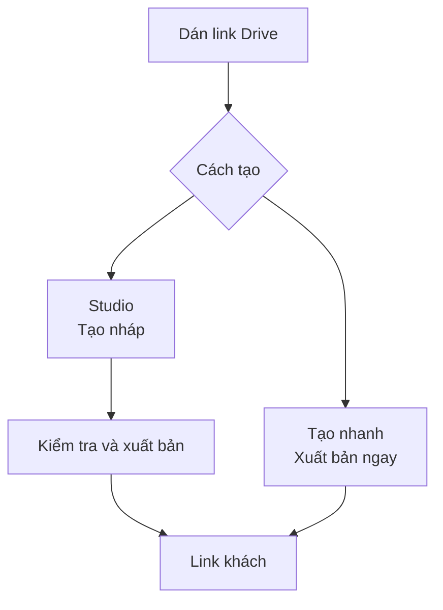
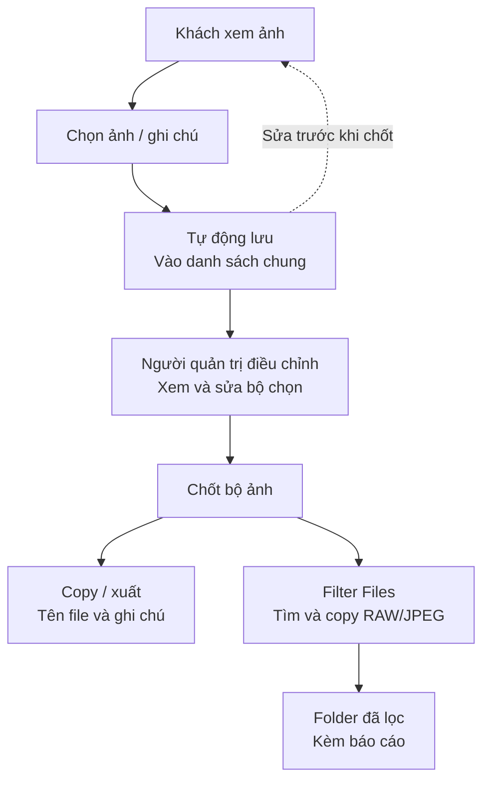

# Luồng cốt lõi: Tạo album → Chọn ảnh → Lọc file

Hai sơ đồ dưới đây mô tả flow cốt lõi của code hiện tại. Album dùng nguồn ảnh từ folder Google Drive được chia sẻ công khai; file RAW/JPEG được lọc và copy ngay trong trình duyệt của người quản trị, không tải lên Zeno.

## 1. Tạo album và lấy link khách

Studio có tài khoản tạo album nháp để kiểm tra rồi xuất bản. Tạo nhanh không cần đăng nhập và trả thêm link quản trị bí mật; người tạo cần lưu link này.

## 2. Khách chọn ảnh và người quản trị lọc file

“Người quản trị” là thành viên studio có quyền chốt hoặc người giữ link quản trị của album tạo nhanh. Khách có thể sửa danh sách khi album còn mở; sau khi chốt, muốn khách chọn tiếp phải mở một vòng chọn mới. Mỗi lần chốt tạo một snapshot cố định; copy/xuất và Filter Files dùng snapshot đó, không dùng bộ lọc tìm kiếm đang hiển thị trên màn hình.

Filter Files tạo folder đích và báo cáo trên máy. Ứng dụng không ghi trạng thái “Đã lọc” lên album và không quản lý các bước hậu kỳ, duyệt ảnh chỉnh hay bàn giao.
